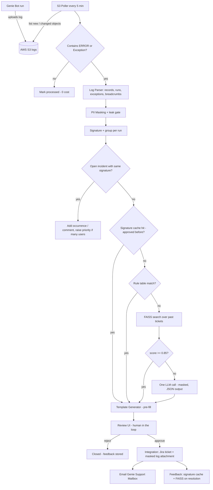
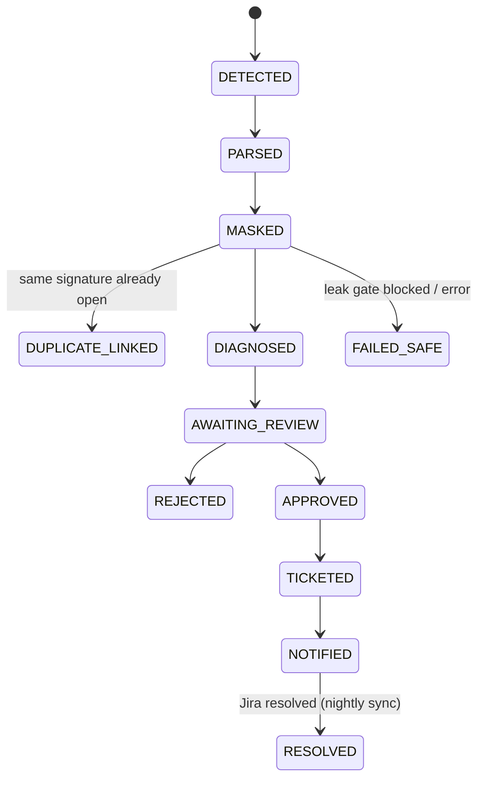

# Genie AI Agent – POC Planning Document

| | |
|---|---|
| **Version** | 2.0 (replaces the v1 `IMPLEMENTATION_PLAN.md`) |
| **Status** | Draft for review |
| **Scope** | Proof of concept: AI-assisted L1 triage for Genie Bot (C#/.NET) production failures |
| **Key decisions** | S3 polling (no Genie code change) · local FAISS · internal AI platform models · human approval before any ticket · PII masked before anything leaves the agent |

---

## 1. Summary

Genie Bot writes execution logs to AWS S3. Today, when a run fails, the end user fills a support
template by hand, emails it, and Prod Support searches S3 and creates a Jira ticket by hand.

The POC builds a Python service that:

1. **Polls S3** on a timer for new or changed Genie logs.
2. **Parses** each log, groups the errors per bot run, and finds the .NET exception and stack trace.
3. **Masks PII and sensitive business identifiers** before any data goes to the LLM, embeddings, Jira or email.
4. **Diagnoses** the failure: known-error cache → rule table → similar past tickets (local FAISS) → one LLM call only when needed.
5. **Pre-fills the support template** and puts it in a **review screen** (human-in-the-loop).
6. After approval, **creates the Jira ticket** (L2 queue) with the masked log attached and **emails** the Genie Support Mailbox.

Because token usage costs money, the design is **deterministic first, LLM last**: most repeat
failures should cost **0 LLM tokens**, and a new failure about **1.5–2k tokens**.

### 1.1 In scope / out of scope

| In scope (POC) | Out of scope (later) |
|---|---|
| S3 polling, log parsing, run grouping | Genie C# webhook (`POST /incidents`) |
| PII masking with an egress leak check | Automatic rerun (needs a Genie rerun API) – POC only *recommends* a rerun |
| Rule + FAISS + LLM diagnosis | Reading the bot machine's working directory |
| Template pre-fill, review UI | Production hardening (HA, shared vector DB, SSO) |
| Jira test project + email | Detecting hung bots that never log an error |
| Token metering and budgets | |

---

## 2. What the Genie logs look like (from the shared sample)

Sample (identifiers replaced here with **fake** values):

```text
5/20/2026 2:17:26 AM	IM PROD Bot triggered;
5/20/2026 2:17:26 AM	Bot Version:Ver. 1.0.5.14(x64);
5/20/2026 2:16:20 AM	[INFO] : Role selected =Icon Creator;
5/20/2026 2:17:26 AM	[INFO] : Tried to login to Icon with id = ABCD12;
5/20/2026 2:17:29 AM	[INFO] : Running Duplicate check;
5/20/2026 2:17:48 AM	[INFO] : File Maintenance - Assets window opened;
5/20/2026 2:17:48 AM	[INFO] : Checking duplicate for 0263494;
5/20/2026 2:17:53 AM	[INFO] : Checking duplicate for I=US0378331005;
5/20/2026 2:17:59 AM	[ERROR] : TestStack.White.AutomationException: Couldn't find window with title Icon - Alternate Assets in process 29160, after waiting for 30 seconds
   at TestStack.White.Factory.ChildWindowFactory.WaitTillFound(Func`1 find, String message) in c:\TeamCity\buildAgent\work\89a2...\src\TestStack.White\Factory\ChildWindowFactory.cs:line 40
   at TestStack.White.Factory.WindowFactory.CreateWindow(String title, Process process, ...) in c:\TeamCity\...\WindowFactory.cs:line 75
   at TestStack.White.Application.GetWindow(String title, InitializeOption option) in c:\TeamCity\...\Application.cs:line 181
   at Others.DuplicateCheckIcon.RunDuplicateCheck(Workbook wb) in C:\Users\12345678\source\repos\Release 18-05-2026\IM_PROD_Office365\Others\DuplicateCheckIcon.cs:line 382;
5/20/2026 2:18:04 AM	[INFO] : Checking duplicate for I=GB0002634946;
5/20/2026 2:18:09 AM	[ERROR] : TestStack.White.AutomationException: Couldn't find window ... (same trace again)
```

### 2.1 Findings that shape the design

| # | Observation | Design impact |
|---|---|---|
| F1 | A line starts with `M/D/YYYY h:mm:ss AM/PM`, then a tab, then optional `[LEVEL] :`, and ends with `;` | Line regex in §4.2. Strip trailing `;`. |
| F2 | Some lines have no level (`Bot triggered`, `Bot Version`) | Treat as `RAW` level; use them as run markers / metadata. |
| F3 | Stack-trace lines don't start with a timestamp | Multi-line records: any line without a timestamp belongs to the record above. |
| F4 | Timestamps are **out of order** (2:16:20 appears after 2:17:26), no time zone | Order events by **line number**, not timestamp. Agree the time zone with the Genie team. |
| F5 | No run ID in the log; `IM PROD Bot triggered` starts a run | Run ID = `S3 key + line number of "Bot triggered"`. One file may hold several runs. |
| F6 | The **same error repeats for every item** in a loop (one per security checked) | Group errors by **(run, error signature)** → one incident with "N occurrences, affected items". This also saves tokens and stops duplicate tickets. |
| F7 | INFO lines are business steps ("Running Duplicate check", "Assets window opened") | Keep the last steps before the error as **breadcrumbs** – the most useful context for diagnosis. |
| F8 | Exception is from a 3rd-party UI-automation library (`TestStack.White`); the bot's own frame is `Others.DuplicateCheckIcon.RunDuplicateCheck` | Signature uses exception type + message template + **own-code** frames; library frames are kept short. |
| F9 | Volatile values: process id `29160`, `30 seconds`, TeamCity build hash, release folder date, line numbers | Normalise them out of the signature so the same failure always gets the same signature. |
| F10 | Sensitive data: app login id, Windows user/employee id in path, securities identifiers (ISIN, SEDOL with `I=` prefix) | Masking catalogue in §5. **The current config regexes miss most of these** (§5.4.1). |

---

## 3. End-to-end workflow



### 3.1 Incident states



Every transition is written to an `audit` table (who/what/when, never raw values). Any stage that
fails leaves the incident in its last state and retries on the next poll – nothing is lost.

---

## 4. Stage-by-stage design

Each stage lists: input → output, whether it costs tokens, and failure handling.

### 4.1 Stage 1 – S3 Poller (no tokens)

| Item | Design |
|---|---|
| Schedule | Every `POLL_INTERVAL_MIN` (default 5). APScheduler or a simple loop; one instance only (file lock). |
| Listing | `ListObjectsV2` on `s3_log_prefix` (use date/bot sub-prefixes if the layout has them, so we don't list the whole bucket). |
| What's new | `s3_objects` table stores `key, etag, size, last_modified, status`. Process if key is new **or** its ETag changed. |
| Run finished? | Only pick objects whose `LastModified` is older than `SETTLE_MIN` (default 3) so we don't read a log that is still being written. |
| First start | Back-fill only the last `BACKFILL_HOURS` (default 24), not the whole history. |
| Pre-filter | Stream the object; if it has no `[ERROR]`, `Exception` or `FATAL`, mark `NO_ERROR` and stop. Most logs end here at zero cost. |
| Re-uploads | If an object is re-uploaded with more content, it is parsed again; incidents are idempotent on `(run_id, signature)`, so no duplicates. |
| Access | IAM role / AWS profile with **read-only** `s3:ListBucket` + `s3:GetObject` on the log prefix. No access keys in code. |
| Latency | Poll interval + settle time → ticket draft within ~5–10 min of the failure. Fine for the POC. |

### 4.2 Stage 2 – Log Parser (no tokens)

1. **Split into records** (F1–F3):
   ```python
   LINE = re.compile(
       r'^(?P<ts>\d{1,2}/\d{1,2}/\d{4} \d{1,2}:\d{2}:\d{2} [AP]M)\s+'
       r'(?:\[(?P<level>[A-Z]+)\]\s*:\s*)?(?P<msg>.*?);?\s*$')
   ```
   Lines that don't match are continuation lines of the previous record (stack traces, wrapped text).
2. **Split into runs** (F5) on `Bot triggered`; capture metadata: bot name (`IM PROD`), version
   (`1.0.5.14`), role (`Icon Creator`).
3. **Extract exceptions** from `ERROR` records:
   - header: `(?P<type>[\w.]+(?:Exception|Error))(?::\s*(?P<message>.*))?`
   - frames: `^\s*at (?P<method>[^(]+)\((?P<args>[^)]*)\)(?: in (?P<file>.+):line (?P<line>\d+))?`
   - inner exceptions: `--->` and `--- End of inner exception stack trace ---`.
4. **Classify frames**: `LIBRARY` (`System.*`, `Microsoft.*`, `TestStack.White.*`, configurable list) vs `OWN` (everything else, e.g. `Others.DuplicateCheckIcon`).
5. **Breadcrumbs** (F7): the last 10 INFO messages before the first error in the run, deduplicated, plus the *current step* (last "Running …" / "… clicked" line).
6. **Failed item** (F6): the item from the last "Checking … for X" line before each error → used for the affected-items list (masked).

Output: `ParsedRun { run_id, bot, version, role, breadcrumbs, errors[] }` – kept in memory only until masked.

### 4.3 Stage 3 – PII masking (no tokens)

Runs **immediately after parsing**, before anything is stored, embedded, sent or logged. Full design in §5.

### 4.4 Stage 4 – Signature and grouping (no tokens)

- Normalise the message: numbers → `<N>`, GUIDs → `<GUID>`, quoted/file paths → `<PATH>`, masked tokens stay as their type (`<ISIN>`).
  Example: `Couldn't find window with title Icon - Alternate Assets in process <N>, after waiting for <N> seconds`.
- **Signature** = `sha1(exception_type | normalised_message | top 3 OWN frames as Namespace.Class.Method)`.
  Line numbers and file paths are **not** in the signature (they change per release).
- **Group** all errors in a run with the same signature into one incident: `occurrences`,
  `first_at`, `last_at`, `affected_items` (masked tokens), `current_step`.
- **Dedup across runs**: if an incident with the same signature is already open (not yet
  resolved) → link this run to it (`DUPLICATE_LINKED`), increase the count, and if the number of
  distinct runs/users ≥ `multi_user_priority_threshold` (3) → raise priority. No new ticket.

### 4.5 Stage 5 – Diagnosis (tokens only on the last step)

Checked in this order; stop at the first hit:

| Step | Source | Cost | Result used |
|---|---|---|---|
| 5a | **Signature cache** – a human approved a diagnosis for this signature before | 0 | Stored diagnosis |
| 5b | **Rule table** (`config/rules.yaml`) – known exception patterns | 0 | Rule's category, cause, fix, rerun flag |
| 5c | **FAISS** over past tickets, score ≥ `high_confidence_threshold` (0.85) | 1 small embedding call | Past ticket's root cause + resolution |
| 5d | **LLM** – score < 0.85 (with the best 3 matches if ≥ 0.75) | ~1.5–2k tokens | JSON diagnosis |

Example rule (matches the sample log):

```yaml
- id: UI_WINDOW_NOT_FOUND
  match:
    exception_type: TestStack.White.AutomationException
    message_regex: "Couldn't find window with title"
  category: UI_TIMING          # TRANSIENT | UI_TIMING | DATA | CONFIG | CODE | UNKNOWN
  probable_causes:
    - Target application (ICON) slow or not responding when the window was requested
    - Unexpected pop-up / modal dialog in front of the expected window
    - Window title changed after an application upgrade
    - Bot machine session locked / RDP minimised (UI automation needs an active desktop)
  suggested_fix: >
    Check that ICON is responsive on the bot machine and close any pop-up; rerun the bot.
    If it repeats across runs, check the window title in the current ICON version and
    increase the wait time or add pop-up handling (code change – L2).
  rerun_recommended: true      # duplicate check is read-only
  escalate_if_repeats: 2       # same signature in 2+ runs → escalate to L2 as a code/config issue
```

LLM call (only for 5d):
- Temperature 0.1, `max_tokens` 600, **JSON only**, validated with Pydantic; one retry only if the JSON is invalid.
- Prompt = short fixed system prompt + masked incident (exception, normalised message,
  compacted frames: library frames as method names only, own frames with file:line, breadcrumbs,
  occurrences) + up to 3 similar past tickets (≤ 120 tokens each).
- Output fields: `category, root_cause, suggested_fix, rerun_recommended, confidence, summary, impact, related_tickets`.
- Output goes through the **leak gate** too (the model must not echo anything unmasked).

### 4.6 Stage 6 – Decision (no tokens)

| Condition | Action |
|---|---|
| `rerun_recommended` and category TRANSIENT / UI_TIMING and first occurrence | Template says **"Rerun recommended"**; reviewer can close it as "rerun by user" without a ticket. |
| Repeats in ≥ `escalate_if_repeats` runs, or category DATA / CONFIG / CODE / UNKNOWN | Escalate → Jira L2. |
| Confidence < 0.5 | Escalate, marked "low confidence – needs investigation". |

Automatic rerun is **not** in the POC (polling means no Genie integration). The audit records
what *would* have been rerun, to size the benefit for phase 2.

### 4.7 Stage 7 – Template Generator (no tokens)

Fill the support template (`TEMPLATE_CSV_PATH`) with Jinja2 from incident metadata + diagnosis.
No extra LLM call – the diagnosis JSON already has the text fields.

| Template field | Source |
|---|---|
| Bot / process / version / role | Parser metadata |
| Run time, occurrences, affected items | Grouping (masked tokens) |
| Error | Exception type + normalised message |
| Step where it failed | `current_step` + breadcrumbs |
| Root cause / suggested fix | Diagnosis (cache / rule / history / LLM – source shown) |
| Similar past tickets | FAISS matches |
| Log location | S3 bucket/key (raw log stays in S3) |

### 4.8 Stage 8 – Human-in-the-loop review

Streamlit app (POC), internal network only:
- Queue of `AWAITING_REVIEW` incidents, newest first.
- Shows the pre-filled template, masked trace, breadcrumbs, similar tickets, diagnosis **source** and confidence.
- Reviewer can edit any field, add comments, then **Approve & submit**, **Close (rerun by user)** or **Reject**.
- Masked by default. An optional **Reveal** button re-reads the raw log from S3 for that reviewer only (see §5.7) – nothing raw is stored by the agent.
- Edits are saved as feedback (signature cache + evaluation data).

### 4.9 Stage 9 – Integration (no tokens)

- **Jira**: `POST /rest/api/2/issue` (project `jira_project_key`, label `jira_l2_queue_label`,
  priority from §4.4), then attach the **masked** log excerpt (the run's lines ± 50 around the
  errors) via `/issue/{key}/attachments`. The S3 key is in the description so L2 can open the raw log with their own access.
- **Email**: SMTP/Graph to the Genie Support Mailbox: summary + Jira link (no log attachment in email).
- Idempotency key = `incident_id`; retry with back-off; failures go back to `APPROVED` and retry next cycle.
- Both payloads go through the leak gate before sending.

### 4.10 Stage 10 – Feedback loop

- Approved diagnoses → signature cache (next time = 0 tokens).
- Nightly job reads resolved Jira tickets for our incidents → adds them (masked) to FAISS.
- Weekly report: incidents, % zero-token, tokens/cost, accuracy from reviewer edits.

---

## 5. PII and sensitive-data masking design

### 5.1 Principles

1. **Mask at ingest** – right after parsing, before storage, embeddings, LLM, Jira, email or the agent's own logs.
2. **Fail closed** – if the leak gate finds an unmasked high-risk value, the payload is **not sent**; the incident goes to `FAILED_SAFE` for a human.
3. **Typed, consistent placeholders** – `<ISIN_1>`, `<ISIN_2>`, `<LOGIN_ID_1>`: the LLM still understands "two different securities, one login", and the same value always gets the same token inside one incident.
4. **Prefer over-masking for identifiers, avoid it for technical text** – an allow-list keeps exception types, namespaces, window titles and app names readable (the diagnosis depends on them).
5. **No raw copy in the agent** – the raw log stays in S3 (already the system of record, already access-controlled). The agent stores masked text only.
6. **Deterministic and local** – regex, checksums and an optional local NER model. No tokens spent on masking, and no data sent anywhere to mask it.

### 5.2 Data classification (from the sample and typical Genie logs)

| Data | Example (fake) | Class | Treatment |
|---|---|---|---|
| Windows user / employee id in path | `C:\Users\12345678\` | PII | Mask `<EMP_ID>` |
| Application login id | `with id = ABCD12` | PII / credential-related | Mask `<LOGIN_ID>` |
| Passwords, tokens, connection strings | `pwd=...`, `Bearer ...` | Secret | Mask `<SECRET>` – value never kept even in memory after masking |
| ISIN | `US0378331005`, `I=GB0002634946` | Confidential business | Mask `<ISIN>` |
| SEDOL | `0263494` | Confidential business | Mask `<SEDOL>` |
| CUSIP, Trade IDs, Account numbers | `TRADE-123456`, `ACC_123456` | Confidential business | Mask `<CUSIP>`, `<TRADE_ID>`, `<ACCOUNT>` |
| Email, phone, person names | `john.doe@bank.com` | PII | Mask `<EMAIL>`, `<PHONE>`, `<PERSON>` |
| Hostnames, IPs, internal URLs | `10.1.2.3`, `srv01.corp` | Internal infra | Mask `<HOST>`, `<IP>`, `<URL>` |
| Workbook / file names with client names | `ClientX_Positions.xlsx` | Confidential | Mask file name, keep extension `<FILE>.xlsx` |
| Process id, wait seconds, build hash | `29160`, `30`, `89a2...` | Technical, not sensitive | Not masked; normalised for the signature only |
| Exception types, namespaces, window titles, app names | `TestStack.White...`, `Icon - Alternate Assets`, `ICON` | Technical | **Kept** (allow-list) |

The final classification and list must be signed off by InfoSec / Data Protection in Phase 0.

### 5.3 Masking pipeline (layers)

```
raw record ─► L1 Secrets ─► L2 Context rules ─► L3 Pattern + checksum ─► L4 NER (optional)
           ─► L5 Allow-list restore ─► L6 Leak gate (at every egress point) ─► masked record
```

| Layer | What it does | Why |
|---|---|---|
| L1 Secrets | `password=`, `pwd=`, `token`, `Authorization:`, `Bearer`, connection strings, JWTs (`eyJ...`) → `<SECRET>` | Highest risk first |
| L2 Context rules | Mask the value after a known key: `id =`, `user`, `login`, `for I=`, `Checking duplicate for`, `account`, `\Users\` | Catches values with no fixed format (login ids, SEDOLs written without checksum) |
| L3 Pattern + checksum | Regex for ISIN / SEDOL / CUSIP / email / IP / phone / trade / account; **checksum** (ISIN Luhn, SEDOL weights, CUSIP) when there is no context | High recall with context, high precision without it |
| L4 NER (optional) | Microsoft Presidio + local spaCy model for person names / locations in free text | Free text (user comments, error messages) may contain names; runs locally, no token cost |
| L5 Allow-list | Never mask exception types, `Namespace.Class.Method`, window titles from the rule table, app names, log keywords | Keeps the diagnosis quality |
| L6 Leak gate | Re-scans the **final payload** (LLM prompt, LLM answer, embedding text, Jira body/attachment, email, agent log line) with the high-risk patterns; any hit → block + alert | Defence in depth |

Implementation: one `Masker` class used everywhere (`masker.mask(text, ctx) -> (masked, counts)`),
with recognizers defined in `config/masking.yaml` so new patterns need no code change.
Presidio's custom recognizers can host L2/L3 if we use it; otherwise plain Python.

### 5.4 Recognizer catalogue (first version)

| Type | Pattern (simplified) | Context words | Validator | Placeholder |
|---|---|---|---|---|
| EMP_ID (user path) | `(?i)(?<=\\Users\\)[^\\\s]+` | – | – | `<EMP_ID_n>` |
| LOGIN_ID | `(?i)(?<=\bid\s?=\s?)\w+` | id, user, login | – | `<LOGIN_ID_n>` |
| ISIN | `\b[A-Z]{2}[A-Z0-9]{9}\d\b` | `I=`, isin, duplicate for | ISIN check digit (if no context) | `<ISIN_n>` |
| SEDOL | `\b[B-DF-HJ-NP-TV-Z0-9]{6}\d\b` | sedol, duplicate for | SEDOL check digit (if no context) | `<SEDOL_n>` |
| CUSIP | `\b[0-9A-Z]{8}\d\b` | cusip | CUSIP check digit | `<CUSIP_n>` |
| TRADE_ID | `\bTRADE[-_]?\d{6,12}\b` | – | – | `<TRADE_ID_n>` |
| ACCOUNT | `\bACC[-_]?\d{6,12}\b` | account, a/c | – | `<ACCOUNT_n>` |
| GENERIC_ID | `\b\d{8,12}\b` | only with context (id, no, ref, account) | – | `<NUM_ID_n>` |
| EMAIL | standard email regex | – | – | `<EMAIL_n>` |
| IP | IPv4 / IPv6 | – | octet range | `<IP_n>` |
| HOST / URL | internal domain suffixes from config, `https?://...` | – | – | `<HOST_n>`, `<URL_n>` |
| PHONE | international / local formats | phone, tel, mobile | min digits | `<PHONE_n>` |
| SECRET | key=value secrets, `Bearer \S+`, JWT, connection string `Password=...;` | – | – | `<SECRET>` |
| FILE | `[\w\- ]+\.(xlsx|xls|csv|txt|pdf)` in business paths | – | allow-list of known template names | `<FILE_n>.ext` |
| PERSON | Presidio NER | – | score ≥ 0.7 | `<PERSON_n>` |

#### 5.4.1 Gaps in the current ideation config (tested on the sample)

| Value in sample | Current config pattern | Result |
|---|---|---|
| ISIN with letters (`SA16…` type) | `\b[A-Z]{2}\d{10}\b` | **Not masked** – ISINs can have letters in positions 3–11 |
| SEDOL (`BN7…` type, 7 chars) | none | **Not masked** |
| Login id after `id =` | none | **Not masked** |
| Employee id in `C:\Users\…` | `\b\d{8,12}\b` | Masked only by luck (8 digits); alphanumeric user ids would leak |
| Numeric-only ISIN (`XS28…` type) | `\b[A-Z]{2}\d{10}\b` | Masked |

The prototype recognizers in §5.4 masked all five sample identifiers correctly (checksums of the
sample ISINs and SEDOL validate), and left exception types, window title and PID untouched.

### 5.5 Consistent placeholders without storing raw values

- Inside one incident: a counter per type (`<ISIN_1>`, `<ISIN_2>`) in first-seen order – the
  same value gets the same token in the prompt, template, Jira and email.
- Across incidents (for dedup/analytics only): `HMAC-SHA256(secret_key, value)[:12]` stored as a
  **fingerprint**, never the value. Lets us say "this ISIN failed in 3 runs" without storing it.
- The HMAC key lives in the secrets store / env var, not in the repo.

### 5.6 Where masked vs raw data lives

| Location | Content |
|---|---|
| S3 (existing) | Raw log – unchanged, existing access controls |
| Agent memory during parsing | Raw – discarded right after masking |
| SQLite (`incidents`, `audit`, caches) | Masked text, fingerprints, counts only |
| FAISS index + metadata | Masked text only (historical tickets are masked before embedding) |
| LLM / embedding API | Masked only, after leak gate |
| Jira / email | Masked only, after leak gate; S3 key so L2 can open the raw log |
| Agent's own logs | Ids, states, counts – **never** log lines or values |

### 5.7 Re-identification ("Reveal") policy

- Default: nobody sees raw values through the agent.
- Option for reviewers: **Reveal** re-reads the raw log from S3 with the reviewer's own access,
  masks it again with the same deterministic numbering, and shows the mapping on screen only.
  Nothing is written to disk. Each reveal is audited.
- Whether Jira may contain real identifiers (L2 may need them to fix data) is an **InfoSec
  decision**: `JIRA_UNMASK_TYPES` (default empty) lets us allow e.g. `ISIN` later without code changes.

### 5.8 Testing and acceptance for masking

- **Golden corpus**: 50–100 real failed-run logs, hand-labelled in a secure location (not in Git).
  Synthetic fixtures with fake values go in `tests/fixtures/`.
- **Targets**: 100 % recall on secrets, login/employee ids and securities identifiers in the
  corpus; ≥ 95 % precision (allow-list protects technical text); zero leak-gate escapes.
- **Unit tests** per recognizer (positive, negative, checksum edge cases, `0`/`O` confusion).
- **Property test**: inject random fake identifiers into real log lines → must always be masked.
- **Red-team review** with InfoSec on a sample of masked payloads before the pilot.
- **Regression**: any leak found later becomes a new test case + recognizer.

---

## 6. Worked example – the sample log through the pipeline

| Stage | Output |
|---|---|
| Poller | New object `<prefix>/.../run.log`, settled, contains `[ERROR]` → process |
| Parser | 1 run (`IM PROD`, v1.0.5.14, role `Icon Creator`); 16 records; 2 ERROR records; breadcrumbs: `Process Icon button clicked → Logged into ICON → File Maintenance - Assets window opened → Checking duplicate for …`; current step `Running Duplicate check` |
| Masking | `id = <LOGIN_ID_1>`, `for <SEDOL_1>`, `I=<ISIN_1>`, `I=<ISIN_2>`, `C:\Users\<EMP_ID_1>\…` |
| Signature | `TestStack.White.AutomationException \| Couldn't find window with title Icon - Alternate Assets in process <N>, after waiting for <N> seconds \| Others.DuplicateCheckIcon.RunDuplicateCheck` → `sha1 = 7f3c…` |
| Grouping | **1 incident**, 2 occurrences, affected items `<ISIN_1>, <ISIN_2>` |
| Diagnosis | Cache miss → **rule `UI_WINDOW_NOT_FOUND` hit** → category `UI_TIMING`, rerun recommended. **0 LLM tokens.** |
| Decision | First occurrence → "Rerun recommended"; if the same signature appears in a 2nd run → escalate to L2 |
| Template | Pre-filled: bot, version, step, error, probable causes, suggested fix, S3 key |
| Review | Reviewer approves or closes as "rerun by user" |
| Jira / email | Only if escalated: ticket in L2 queue + masked excerpt; email with Jira link |

If no rule existed, the LLM prompt for this incident would be about **1.2k input tokens**
(compacted trace + breadcrumbs + 3 matches), output ≤ 600.

> Side observation for the Genie team: the bot kept trying every item after the window was
> lost, failing each one the same way. A "stop after N identical consecutive failures" guard in
> Genie would cut noise and wasted runtime. (Recommendation only – not part of the POC.)

---

## 7. Token and cost controls

| Control | Setting |
|---|---|
| Run grouping | N identical errors in a run = 1 incident = at most 1 diagnosis |
| Zero-token paths | Logs without errors, duplicates of open incidents, signature cache, rule table, FAISS ≥ 0.85 |
| LLM calls per incident | Max 1 (+1 retry only for invalid JSON) |
| Prompt size | ≤ 2k input tokens: library frames as method names, own frames with file:line, ≤ 10 breadcrumbs, ≤ 3 past tickets × 120 tokens |
| Output | JSON only, `max_tokens` 600, temperature 0.1 |
| Embeddings | Batched (50–100 per call), cached by text hash; incident query text ≤ 300 tokens |
| Budgets | `MAX_TOKENS_PER_INCIDENT` (3000), `DAILY_TOKEN_BUDGET` (set with the platform team). Over budget → history/rule-only diagnosis, flagged for the reviewer |
| Kill switch | `LLM_ENABLED=false` – everything else still works |
| Metering | `token_usage` table (incident, model, tokens in/out, cache hit, latency) + daily summary |
| Model choice | Smallest platform model that passes the eval set; static system prompt first so platform-side prompt caching (if offered) can help |

---

## 8. Knowledge base (local FAISS)

- **Sources**: historical Jira export (`JIRA_CSV_PATH`) + support templates (`CSV_PATH`). Use only resolved tickets with a real resolution.
- **One document per ticket**: summary + exception type + key frames + root cause + resolution, **masked**, ≤ 300 tokens. Comments and long descriptions are not embedded.
- **Index**: `faiss.IndexFlatIP` on L2-normalised vectors (cosine) at `INDEX_PATH`; metadata (ticket key, status, resolution, signature, masked text) at `META_PATH` (SQLite/JSON).
- `embedding_dimensions` is checked against the model at start-up – fail fast on mismatch.
- **Build**: `scripts/build_index.py` – one-time, batched, cached; then incremental nightly for newly resolved tickets. Rough cost: 5,000 tickets × 300 tokens ≈ 1.5M embedding tokens once.
- Flat index is fine at POC scale (≤ ~100k vectors). Move to a shared store only for production.

---

## 9. Data model (SQLite)

| Table | Key columns |
|---|---|
| `s3_objects` | key, etag, size, last_modified, status, processed_at |
| `runs` | run_id, s3_key, bot, version, role, started_at, error_count |
| `incidents` | incident_id, signature, state, category, diagnosis_source (cache/rule/history/llm), confidence, occurrences, affected_items (masked), template_json, jira_key, priority, created_at, updated_at |
| `incident_runs` | incident_id, run_id (links duplicates across runs) |
| `signatures` | signature, approved_diagnosis_json, approved_by, approved_at, hit_count |
| `token_usage` | incident_id, model, tokens_in, tokens_out, cache_hit, latency_ms, at |
| `audit` | incident_id, from_state, to_state, actor, details (no raw values), at |
| `masking_stats` | incident_id, type, count (for monitoring, no values) |

---

## 10. Configuration

Keep the ideation `Config`, with these fixes:

1. `validate()` lists `OPENAM_USERNAME` twice – the second should be `OPENAM_PASSWORD`.
2. `validate()` reads `self.jira_api_token`, but the class defines `jira_user_password` → `AttributeError`.
   Use one: Jira Cloud = email + API token, Server/DC = Personal Access Token.
3. `VERIFY_TLS: bool = os.getenv(...)` returns a string, so `"false"` is truthy →
   `os.getenv("VERIFY_TLS", "true").lower() in ("1", "true", "yes")`.
4. `JIRA_CSV_PATH` is a hard-coded personal Windows path → env var.
5. AWS access keys → IAM role / AWS profile; add S3, FAISS and template paths to `validate()`.
6. `llm_temperature` 0.5 → 0.1; `llm_max_tokens` 1000 → 600.
7. Masking patterns move out of the dataclass into `config/masking.yaml`; ISIN regex fixed (§5.4.1).
8. Error text "Copy .env to .env" → "Copy .env.example to .env".

New keys:

```dotenv
# S3 polling
POLL_INTERVAL_MIN=5
SETTLE_MIN=3
BACKFILL_HOURS=24
# Cost controls
LLM_ENABLED=true
MAX_TOKENS_PER_INCIDENT=3000
DAILY_TOKEN_BUDGET=200000
# Masking
MASKING_CONFIG=config/masking.yaml
MASK_HMAC_KEY=<from secrets store>
JIRA_UNMASK_TYPES=
NER_ENABLED=false
# Diagnosis
RULES_CONFIG=config/rules.yaml
ESCALATE_IF_REPEATS=2
# Integration
SMTP_HOST=
SUPPORT_MAILBOX=
REVIEW_UI_PORT=8501
```

---

## 11. Project structure

```
GenieAiAgent/
├── config/
│   ├── settings.py          # fixed Config dataclass + validate()
│   ├── masking.yaml         # recognizers, context words, allow-list
│   └── rules.yaml           # known-error rules (UI_WINDOW_NOT_FOUND, ...)
├── genie_agent/
│   ├── main.py              # starts poller + scheduler
│   ├── orchestrator.py      # state machine, one incident at a time
│   ├── poller.py            # S3 listing, settle, pre-filter
│   ├── parsing/
│   │   ├── log_parser.py    # records, runs, breadcrumbs
│   │   └── dotnet_trace.py  # exception + frame extraction
│   ├── masking/
│   │   ├── masker.py        # layers L1–L5
│   │   ├── validators.py    # ISIN / SEDOL / CUSIP checksums
│   │   └── leak_gate.py     # L6 egress check
│   ├── diagnosis/
│   │   ├── signature.py
│   │   ├── rules.py
│   │   ├── retriever.py     # FAISS search
│   │   └── llm_diagnoser.py # prompt, JSON schema, budget
│   ├── services/
│   │   ├── s3_client.py
│   │   ├── llm_client.py    # OpenAM auth + token cache, metering, retries
│   │   ├── embeddings.py
│   │   ├── vector_store.py
│   │   ├── jira_client.py
│   │   └── mailer.py
│   ├── templating.py
│   ├── models.py            # Pydantic models
│   └── store.py             # SQLite
├── ui/review_app.py         # Streamlit review screen
├── scripts/
│   ├── build_index.py
│   ├── eval_diagnosis.py    # replay past failures: accuracy + tokens
│   └── masking_report.py    # run masker over a folder, report counts/leaks
├── tests/
│   ├── fixtures/            # synthetic Genie logs with FAKE identifiers
│   ├── test_log_parser.py
│   ├── test_masking.py
│   ├── test_signature.py
│   └── test_leak_gate.py
├── .env.example
└── requirements.txt         # boto3, faiss-cpu, numpy, pydantic, jinja2, requests,
                             # apscheduler, streamlit, python-dotenv, pyyaml, pytest
                             # (+ presidio-analyzer, spacy if NER_ENABLED)
```

---

## 12. Delivery plan (7 weeks)

| Phase | Week | Tasks | Deliverable | Exit criteria |
|---|---|---|---|---|
| **0. Setup & sign-offs** | 1 | Access: S3 read-only role, AI platform (LLM + embeddings), Jira test project, SMTP. Confirm S3 layout, time zone, log retention. Collect 50–100 failed-run logs + Jira CSV. **Data classification sign-off with InfoSec** (§5.2). Fix config. | Access checklist, signed classification, sample dataset | All connections tested from the POC host |
| **1. Poller + parser** | 1–2 | `poller.py`, `log_parser.py`, `dotnet_trace.py`, run split, breadcrumbs, signature, grouping. Synthetic fixtures. | Parsed + grouped incidents from real logs (local only) | ≥ 95 % of sample logs parsed correctly; identical errors grouped |
| **2. PII masking** | 2–3 | Recognizers L1–L5, checksums, allow-list, leak gate, `masking_report.py`, golden-corpus tests. NER spike (decide yes/no). | Masker + test report | 100 % recall on high-risk types, ≥ 95 % precision, InfoSec review passed |
| **3. Knowledge base** | 3 | Mask + clean Jira CSV, `build_index.py`, retriever, embedding cache. | FAISS index + metadata | Right past ticket in top-5 for ≥ 70 % of a labelled sample; embedding cost recorded |
| **4. Diagnosis** | 4 | `rules.yaml` (top 10 known errors from history, incl. UI_WINDOW_NOT_FOUND), signature cache, LLM diagnoser with budget + metering, `eval_diagnosis.py`. | Diagnosis for every sample incident | L2 rates ≥ 60–70 % correct/useful; ≥ 50 % of incidents at 0 LLM tokens; avg ≤ 2k tokens on LLM path |
| **5. Template + review UI** | 5 | Jinja template, Streamlit review screen, feedback to cache, Reveal (if approved). | Working review flow | Reviewer handles an incident in < 2 min |
| **6. Integration + end-to-end** | 6 | Jira create/attach/dedup/priority, email, leak gate on both, nightly resolution sync. | Failed run → ticket + email in **test** project | E2E works on 10 replayed real failures with no leaks |
| **7. Shadow pilot** | 7 | Run against live S3 for 1–2 bots; drafts only, compared with what L2 actually did. Daily token report. | Pilot report + go/no-go | Metrics in §14 collected; cost per incident known |

Roles: 1–2 Python developers · Genie team (log layout, time zone, rule knowledge) · L2 SME
(rules, labelling, rating diagnoses) · InfoSec (classification, masking review) · AI platform team (models, quotas, pricing).

---

## 13. Testing strategy

| Level | What |
|---|---|
| Unit | Parser (multi-line, missing level, out-of-order times, multi-run files), each recognizer, checksums, signature stability, budget logic |
| Golden corpus | Real logs (secure location): masking recall/precision, parsing accuracy |
| Contract | Jira / SMTP / LLM clients against mocks; JSON schema validation of LLM output |
| Replay / eval | `eval_diagnosis.py` replays historical failures: accuracy vs actual resolution + tokens per incident |
| E2E | Synthetic log uploaded to a test S3 prefix → ticket in Jira test project |
| Security | Leak-gate tests, InfoSec red-team on masked payloads, secret scanning on the repo |

---

## 14. Success metrics (pilot)

| Metric | Target for go-decision |
|---|---|
| Time from failure to ticket draft | ≤ 10 min (today: manual, hours) |
| Manual effort per incident | Template + log search removed; review < 2 min |
| Diagnosis useful (L2 rating) | ≥ 60–70 % |
| Incidents at 0 LLM tokens | ≥ 50 % (should grow with the cache) |
| Avg tokens per LLM-diagnosed incident | ≤ 2k |
| Duplicate tickets avoided | Counted |
| PII leaks | **0** |

---

## 15. Risks and mitigations

| Risk | Mitigation |
|---|---|
| PII / confidential identifiers reach LLM or Jira | Mask at ingest, checksums + context rules, allow-list, fail-closed leak gate, golden corpus, InfoSec review |
| Over-masking hurts diagnosis | Allow-list for technical text; masking report reviewed with L2 |
| Token cost creeps up | Run grouping, cache, rules, FAISS shortcut, budgets, kill switch, daily report |
| Wrong diagnosis | Grounded in past tickets/rules, source + confidence shown, human approval |
| Log format varies between bots | Parser tests per bot; ask Genie team for a stable header (run id, bot, step) – cheap and very helpful |
| Logs still being written when read | Settle time + ETag re-processing + idempotent incidents |
| Polling delay | 5–10 min is acceptable for POC; webhook / S3 events later |
| Out-of-order timestamps | Order by line number |
| Local FAISS / SQLite single host | Fine for POC; shared stores for production |

---

## 16. Open questions / dependencies (close in Phase 0)

1. S3 layout: key pattern (bot / date / machine / user?), one file per run or per day, file size, retention.
2. Is a log uploaded once at the end of a run, or re-uploaded while running?
3. Time zone of log timestamps.
4. How to identify the **end user / machine** of a run (for the multi-user priority rule) – from the S3 key?
5. AI platform: available LLM + embedding models, price per 1k tokens, rate limits, embedding dimension, prompt caching support.
6. Jira Cloud or Server/DC (API token vs PAT); test project; required fields.
7. Email: SMTP relay or Microsoft Graph; mailbox address.
8. InfoSec: data classification (§5.2), whether Jira may hold real identifiers, whether local NER is allowed, where the golden corpus may be stored.
9. Which known errors should go into the first `rules.yaml` (L2 SME input).
10. POC host: VM/container that can reach S3, AI platform, Jira and SMTP.
